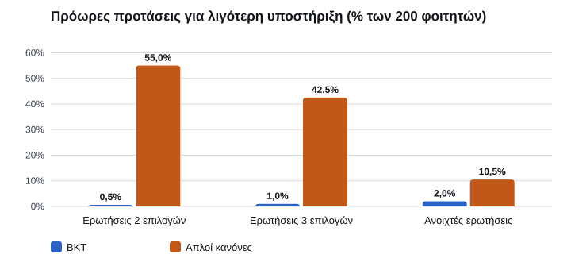

# Προσομοίωση: BKT ή απλοί κανόνες;

200 εικονικοί φοιτητές ανά σενάριο, μία ενότητα με 2 έννοιες, έως 30 απαντήσεις.
Για κάθε φοιτητή ξέρουμε πότε έμαθε πραγματικά κάθε έννοια. Πριν από αυτό απαντά σωστά μόνο με τύχη (ή με βοήθεια), μετά απαντά σωστά εκτός από απροσεξία (10%). Seed 2026: τα αποτελέσματα βγαίνουν πάντα ίδια.

- **Πρόωρη πρόταση**: πρόταση για λιγότερη υποστήριξη ΠΡΙΝ ο φοιτητής μάθει πραγματικά και τις 2 έννοιες.
- **Καθυστέρηση**: πόσες απαντήσεις μετά την πραγματική εκμάθηση ήρθε η πρόταση (διάμεσος).
- **Καμία πρόταση**: δεν ήρθε πρόταση μέσα σε 30 απαντήσεις.

| Σενάριο | Μέθοδος | Πρόωρες προτάσεις | Καθυστέρηση (απαντήσεις) | Καμία πρόταση |
|---|---|---|---|---|
| Ερωτήσεις 2 επιλογών | BKT | 0,5% | 8,0 | 18,0% |
| Ερωτήσεις 2 επιλογών | Απλοί κανόνες | 55,0% | 1,0 | 0,5% |
| Ερωτήσεις 3 επιλογών | BKT | 1,0% | 4,0 | 11,0% |
| Ερωτήσεις 3 επιλογών | Απλοί κανόνες | 42,5% | 1,0 | 1,0% |
| Ανοιχτές ερωτήσεις | BKT | 2,0% | 2,0 | 8,0% |
| Ανοιχτές ερωτήσεις | Απλοί κανόνες | 10,5% | 1,0 | 7,0% |

## Τι σημαίνει

- Με ερωτήσεις 2 επιλογών, οι απλοί κανόνες πρότειναν λιγότερη υποστήριξη **πριν** ο φοιτητής μάθει τις έννοιες στο 55,0% των φοιτητών (τρεις τυχερές σωστές απαντήσεις αρκούν). Το BKT στο 0,5%, γιατί ξέρει ότι στις 2 επιλογές η τύχη είναι 50%.
- Το τίμημα: το BKT προτείνει **αργότερα** (περισσότερες απαντήσεις μετά την εκμάθηση) και σε κάποιους φοιτητές καθόλου μέσα στις 30 απαντήσεις. Προτιμά να περιμένει παρά να αφαιρέσει βοήθεια πολύ νωρίς. Ο φοιτητής μπορεί πάντα να αλλάξει μόνος του τον τρόπο μελέτης.
- Στις ανοιχτές ερωτήσεις η τύχη είναι μικρή, οπότε η διαφορά των δύο μεθόδων μικραίνει.

Παράμετροι BKT από το `backend/config.toml`. Οι απλοί κανόνες είναι αυτοί της ενότητας `[fading]` (3 επιτυχίες στη σειρά με 0–1 υποδείξεις). Η προσομοίωση είναι εικονική: δείχνει πώς συμπεριφέρονται οι δύο μέθοδοι με λογικές υποθέσεις, δεν αντικαθιστά δοκιμή με πραγματικούς φοιτητές.
